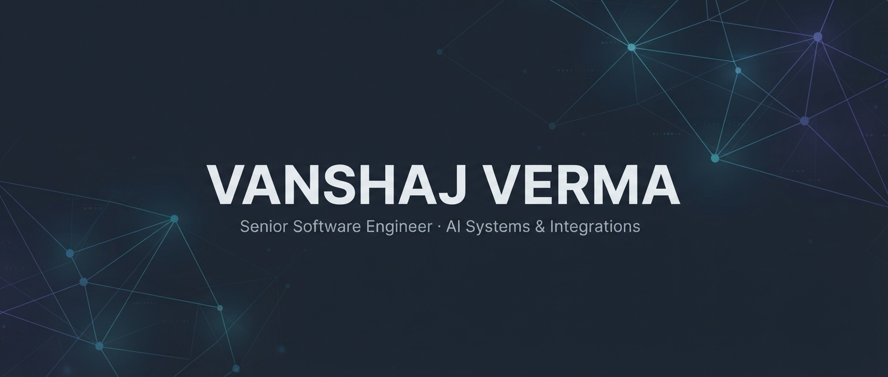
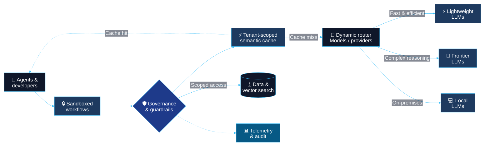
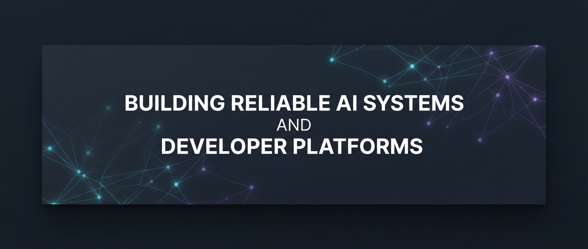

  

    

  
    

  
  
  
  

---

### ⚡ Core AI &amp; Platform Impact

<table>
  <tr>
    <td width="33%" valign="top">
      <h4>🌐 AI Systems</h4>
      
AI gateways with <strong>semantic caching</strong>, dynamic routing, and local LLMs.

    </td>
    <td width="33%" valign="top">
      <h4>🛡️ AI at Scale</h4>
      
<strong>5,000+ developer machines</strong> covered by AI policy, guardrails, and audit trails.

    </td>
    <td width="33%" valign="top">
      <h4>🔀 AI Agents</h4>
      
<strong>Isolated agents</strong> and LLM bots for <strong>30+</strong> workflows.

    </td>
  </tr>
</table>

---

### 🧠 AI Systems &amp; Platform Architecture

An architecture I build for enterprise agentic workflows:

On smaller screens, use the diagram's zoom controls for a closer look.

---

### 🛠️ Tech Stack

<strong>AI &amp; developer platforms</strong> 

  

<strong>Languages &amp; application development</strong> 

  

<strong>Cloud &amp; infrastructure</strong> 

---

### 📊 GitHub Telemetry &amp; Activity

  
  
    
  
    
  

---

### 🤝 Let's connect

  <a href="https://www.linkedin.com/in/vanshaj-verma/"><strong>Connect on LinkedIn</strong></a>
  &nbsp; · &nbsp;
  <a href="mailto:verma.vanshaj.vv@gmail.com"><strong>Drop me an email</strong></a>
    
  

